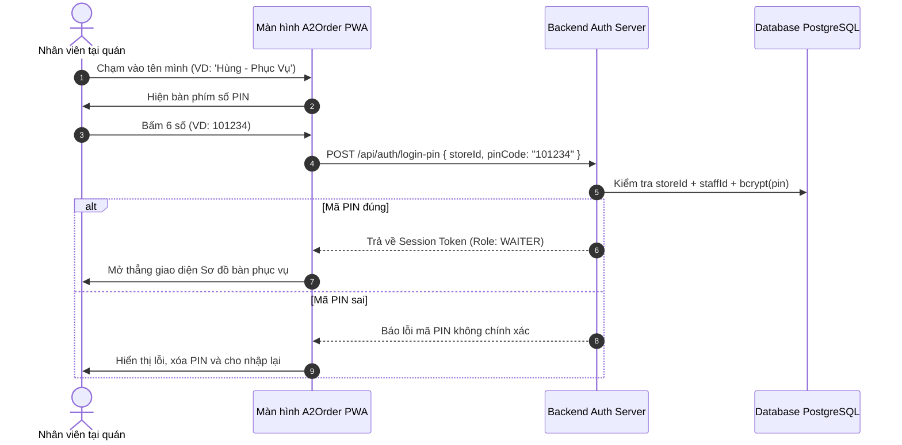

# F01 - ĐA THUÊ THUÊ & PHÂN QUYỀN NHÂN SỰ (MULTI-TENANCY & RBAC)

---

## 1. MỤC TIÊU & TÁC DỤNG (OBJECTIVE & VALUE)
* **Vấn đề thực tế của quán**:
  * Chủ quán sợ bị lộ doanh thu cho nhân viên biết.
  * Nhân viên bàn/bếp hay quên mật khẩu, không thể bắt họ đăng nhập email/mật khẩu phức tạp mỗi lần vào ca.
  * Bạn (Super Admin) cần quản lý từ xa hàng chục quán ăn mà không phải dựng server riêng cho từng quán.
* **Tác dụng mang lại**:
  * Cách ly dữ liệu 100% giữa các quán ăn.
  * Nhân viên đăng nhập siêu tốc bằng **Mã PIN 6 số** trong 1 giây.
  * Giám sát, kích hoạt hoặc khóa tài khoản quán ăn từ xa.

---

## 2. TÁC NHÂN THAM GIA & PHÂN QUYỀN (ACTORS & PERMISSIONS)

| Tác nhân | Quyền hạn trong tính năng | Giao diện sử dụng |
| :--- | :--- | :--- |
| **Super Admin (Bạn)** | Quản lý toàn bộ Store, xem danh sách, đổi trạng thái quán (`ACTIVE`/`SUSPENDED`). | Super Admin Portal (`/admin`) |
| **Chủ nhà hàng (Store Owner)** | Cài đặt thông tin quán, tạo tài khoản nhân viên, cấp mã PIN. | Owner Settings (`/settings/staff`) |
| **Nhân viên (Waiter, Cashier, Chef)** | Nhập PIN 6 số trực tiếp, không chọn tên để vào ca. | Fast PIN Modal (`/login/pin`) |

---

## 3. QUY TRÌNH VẬN HÀNH (WORKFLOW & SEQUENCE)



---

## 4. MA TRẬN TÁC ĐỘNG & PHẠM VI ẢNH HƯỞNG (IMPACT ANALYSIS)

| Thành phần | Mức độ ảnh hưởng | Chi tiết tác động |
| :--- | :--- | :--- |
| **Toàn bộ hệ thống** | Tối cao | Là điều kiện tiên quyết (Gatekeeper) để truy cập mọi tính năng khác. |
| **Bảo mật cơ sở dữ liệu** | Tối cao | Mọi API sau đó đều trích xuất `storeId` từ Token đăng nhập. |
| **Màn hình ca kíp** | Cao | Cho phép bấm "Đổi ca" để khóa màn hình ngay khi hết giờ làm việc. |

---

## 5. THIẾT KẾ KỸ THUẬT & DỮ LIỆU (TECHNICAL SPECS)

### 5.1. API Endpoints
* `POST /api/auth/login-owner`: Đăng nhập Chủ quán bằng Email/Password $\rightarrow$ Cấp JWT Cookie HttpOnly.
* `POST /api/auth/login-pin`: Đăng nhập Nhân viên bằng mã PIN 6 số $\rightarrow$ Cấp Session Token nhẹ.
* `POST /api/admin/stores`: Super Admin tạo nhà hàng mới.

Màn hình POS tải danh sách nhân viên đang hoạt động của đúng `storeId`, mở ngay bàn phím PIN, không chọn nhân viên. Đăng nhập chủ quán yêu cầu email và mật khẩu thực. Lỗi API không tạo session demo hoặc tự gán role; giao diện giữ nguyên màn đăng nhập và báo lỗi để người dùng thử lại.

### 5.2. Schema Validation (Zod)
```typescript
import { z } from 'zod';

export const PinLoginSchema = z.object({
  storeId: z.string().min(1),
  staffId: z.string().min(1),
  pinCode: z.string().regex(/^(10|20|30)\d{4}$/, "Mã PIN phải gồm đúng 6 chữ số"),
});
```

---

## 6. GÓC KHUẤT VẬN HÀNH & XỬ LÝ EDGE CASES

1. **Nhân viên nghỉ việc nhưng vẫn nhớ mã PIN**:
   * *Giải pháp*: Chủ quán chỉ cần 1 chạm chuyển trạng thái nhân viên đó thành `isActive: false` $\rightarrow$ Mã PIN lập tức bị vô hiệu hóa, phiên đăng nhập cũ bị kick ra ngay lập tức.
2. **Nhập sai mã PIN liên tục 8 lần**:
   * *Giải pháp*: Giới hạn thử lại trong 5 phút để chống đoán mò mã PIN (Brute-force protection).

### Quy ước PIN nhân viên 6 số

`10xxxx`: phục vụ; `20xxxx`: thu ngân; `30xxxx`: bếp. Hai số đầu chỉ lọc nhóm quyền; server xác thực đủ sáu số bằng hash của nhân viên đang hoạt động thuộc đúng `storeId`. PIN duy nhất trong một quán. Sau nâng cấp, chủ quán cấp lại các PIN 4 số cũ vì hash không thể chuyển đổi sang mã mới. Giới hạn thử sai áp dụng theo quán và IP.

### Khôi phục mật khẩu qua chủ quán

Màn đăng nhập tài khoản có nút **Quên mật khẩu?**. Client gửi email và storeId đến `POST /api/auth/password-reset-request`. API luôn trả cùng một phản hồi cho email hợp lệ hoặc không tồn tại để tránh dò tài khoản, giới hạn 5 yêu cầu mỗi IP trong 15 phút và không tạo yêu cầu trùng trong 15 phút. Yêu cầu được lưu vào AuditLog theo `storeId` và `staffId`, không ghi mật khẩu. Chủ quán thấy yêu cầu còn chờ trong thông báo và màn Nhân viên của CMS, tự cấp mật khẩu mới bằng API reset credential. Reset làm tăng `sessionVersion`, vô hiệu hóa phiên cũ và ghi sự kiện hoàn tất. Mật khẩu tạm thời được chủ quán chuyển riêng cho đúng nhân viên.

Lựa chọn **Ghi nhớ đăng nhập** chỉ áp dụng với tài khoản email; khi bật, phiên JWT được lưu trong localStorage trên thiết bị hiện tại đến khi hết hạn. Mật khẩu không được lưu. PIN là đăng nhập nhanh, không đồng nghĩa với chấm công hay vào ca. Màn PIN công khai không hiển thị quy ước tiền tố.
